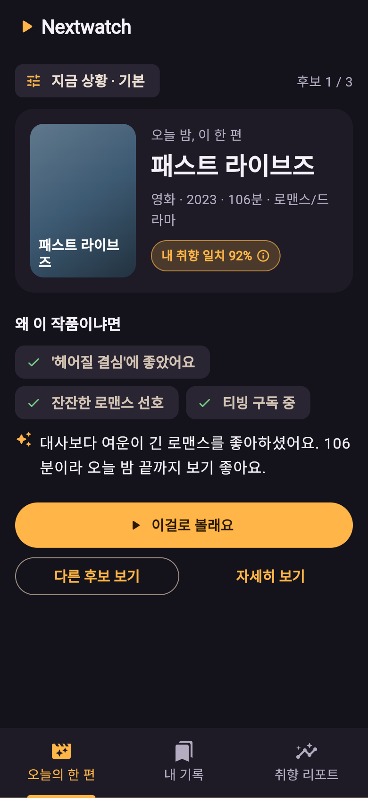
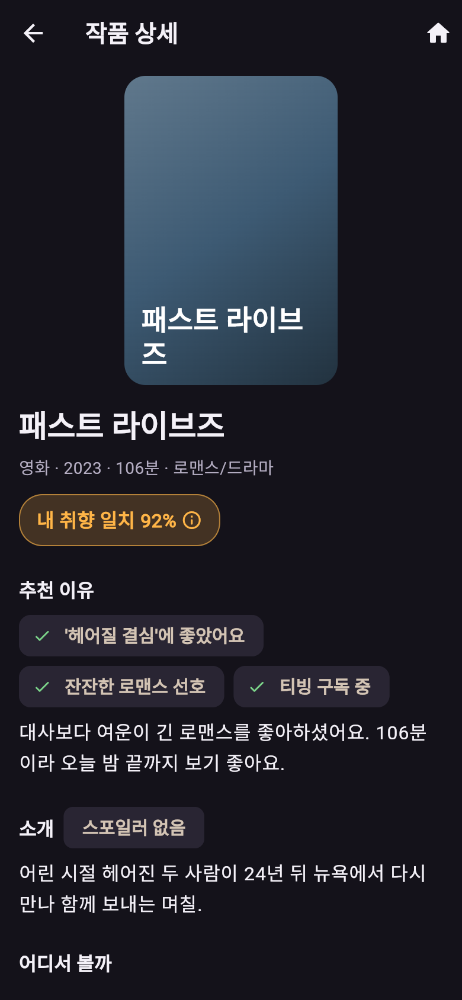
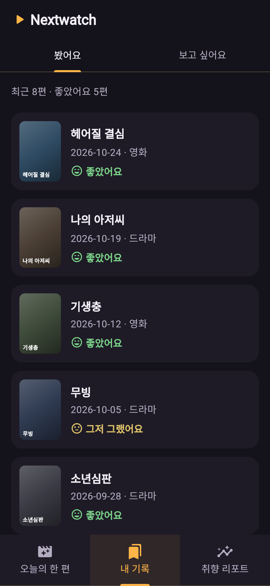
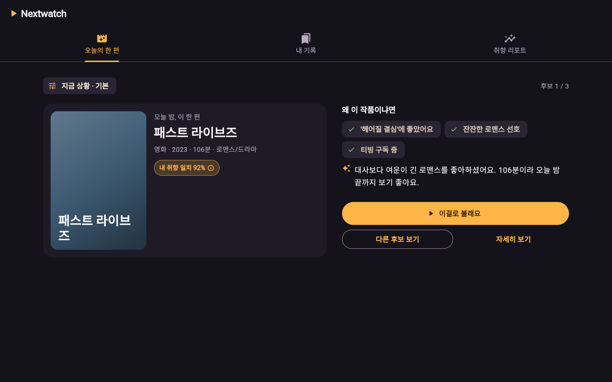

# Nextwatch v2

> 내 취향을 기억하고, 오늘 볼 영화·드라마를 골라준다

GAI3008-01 응용모바일프로그래밍 중간 프로젝트 · UI 시연용 Flutter 앱 (실제 저장 · 로그인 · 결제 · 추천 계산 없음)

---

## 1. 앱 소개

| 칸 | 내용 |
|---|---|
| **앱 이름** | Nextwatch v2 |
| **부제** | 내 취향을 기억하고, 오늘 볼 영화·드라마를 골라준다 |
| **카테고리** | 엔터테인먼트 |
| **대상 사용자 / 사용 상황** | 볼 작품은 많은데 뭘 볼지 고르다 시간을 다 쓰는 OTT 이용자 — 평일 밤 11시, 침대에서 아이폰으로 "한 편만 보고 자고 싶을 때" |
| **설명** | 1. 본 영화 · 드라마를 한 줄로 평가해 두면, 취향을 분석해 오늘 볼 작품을 골라 준다. 2. 유사 앱(키노라이츠)은 랭킹 · 목록이 많아 후보를 직접 비교하다 지친다(리뷰 #15 · 저니 감정 최저점 "비교하기"). 3. v2는 목록 대신 **한 편 + 추천 이유**를 먼저 보여 줘, 2탭 만에 결정하게 한다. |
| **평가 및 리뷰** (유사 앱 키노라이츠) | App Store ★4.3 (548개) · Google Play ★3.3 (약 1,200개) — 대표 리뷰 #12 "반응 개느림. 뭐하나 터치해서 넘어가고 볼라면 한참 기달려야되고" (2024-08-10) |

### 스크린샷

| v1 현행 (키노라이츠) | v2 화면 A · 오늘의 한 편 | v2 화면 B · 작품 상세 | v2 화면 C · 내 기록 | v2 넓은 화면 |
|---|---|---|---|---|
| (아이폰 캡처 넣기) |  |  |  |  |

### 새로운 기능 (v2에서 바뀐 것)

| P번호 | 바뀐 것 (화면 · 요소 번호) | 근거 (리뷰 · 원칙) |
|---|---|---|
| P08 · P03 | A 오늘의 한 편 — 첫 화면에 한 편(A-3) + 다른 후보 최대 3편(A-6) | #15 · 저니 3단계 · 셀프 논증 쟁점 1 |
| P01 · P02 | 추천 이유 칩 3개(A-4) + "내 취향 일치 %" 이름과 설명(A-3a) | #1 "별점이랑 신호등이 어떻게 구분되는지" · 쟁점 2 · 3 |
| P09 · P01 | 로딩 문구와 "다시 시도"가 있는 오류 화면(공통) | #2 · #12 "반응 개느림" · 쟁점 5 |

---

## 2. 실행 방법

필요한 것: Flutter 3.x, Node.js 18 이상

```bash
# 1) 시연용 서버 (터미널 1)
cd mock_server
npm install
npm start            # http://localhost:3000 · 응답 0.8초 지연(로딩 화면을 보이게)

# 2) 앱 (터미널 2, 저장소 맨 위 폴더에서)
flutter pub get
flutter run -d chrome     # 또는 -d macos
```

- 안드로이드 에뮬레이터는 자동으로 `http://10.0.2.2:3000`을 씁니다. 다른 주소는 `--dart-define=API_BASE=http://주소:3000`.
- **오류 상태 보기:** 터미널 1에서 서버를 끄고(Ctrl+C) 앱에서 탭을 옮기거나 "다시 시도"를 누릅니다.
- **빈 상태 보기:** 내 기록 → "보고 싶어요" 탭 (db.json의 `watchlist`가 빈 배열).
- **넓은 화면 보기:** 크롬 창 너비를 840px 이상으로 늘립니다.

### 데모 영상 (1분)

- 링크: (업로드 후 여기에 넣기)

## 3. 화면 목록

| 화면 | 비즈니스 명칭 | 이동 방식 | 파일 |
|---|---|---|---|
| T | 주 메뉴 탭 | TabBar | lib/screens/root_tabs.dart |
| A | 오늘의 한 편 | 탭 · Navigator push(다른 후보) | lib/screens/a_today_pick_screen.dart |
| B | 작품 상세 | Navigator push | lib/screens/b_title_detail_screen.dart |
| C | 내 기록 | 탭 + 안쪽 TabBar | lib/screens/c_history_screen.dart |
| D | 취향 리포트 | 탭 | lib/screens/d_taste_report_screen.dart |
| E | 상황 고르기 시트 | showModalBottomSheet | lib/widgets/sheets.dart |
| F | 한 줄 평가 시트 | showModalBottomSheet | lib/widgets/sheets.dart |
| G | 어디서 볼까 다이얼로그 | showDialog | lib/widgets/sheets.dart |

## 4. json-server GET 목록

| 요청 | 쓰는 화면 |
|---|---|
| `GET /picks?mood={id}&_sort=rank&_order=asc&_expand=title` | A 오늘의 한 편 |
| `GET /titles/{id}` | B 작품 상세 |
| `GET /moods` | E 상황 고르기 시트 |
| `GET /history?_expand=title&_sort=watchedAt&_order=desc` | C 내 기록 · 봤어요 |
| `GET /watchlist?_expand=title` | C 내 기록 · 보고 싶어요 (빈 상태) |
| `GET /taste` | D 취향 리포트 |

POST · PUT · DELETE는 쓰지 않습니다. 추천 결과는 db.json에 미리 정해 둔 임의 결과이며, OTT 제공 정보도 시연용입니다.

## 5. 문서 (docs/)

- [기획.md](docs/기획.md) — 현행 분석 · 사업 요약 · 저니 · 피쉬본/5 Why · 화면 흐름 · 상태관리 포인트
- [디자인가이드.md](docs/디자인가이드.md) — 색 · 글자 · 적응형 · 화면별 요소 분석표와 가이드 글
- [원칙카드.md](docs/원칙카드.md) — P01–P10
- [prompt-log.md](docs/prompt-log.md) — AI에게 맡긴 일과 판단
- [셀프논증.md](docs/셀프논증.md) — 쟁점 5개
- [자가평가.md](docs/자가평가.md)
